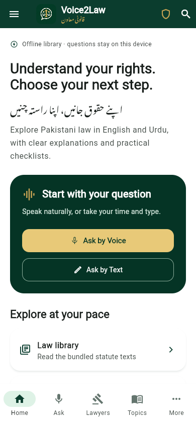
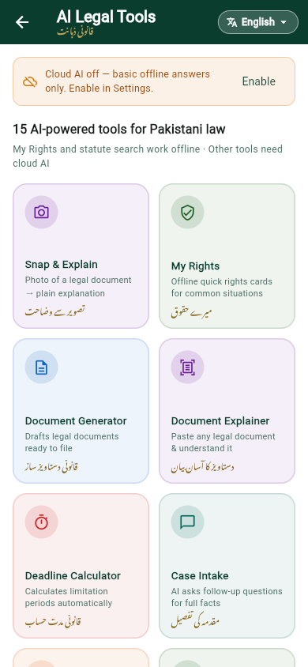
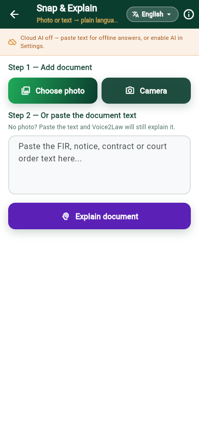
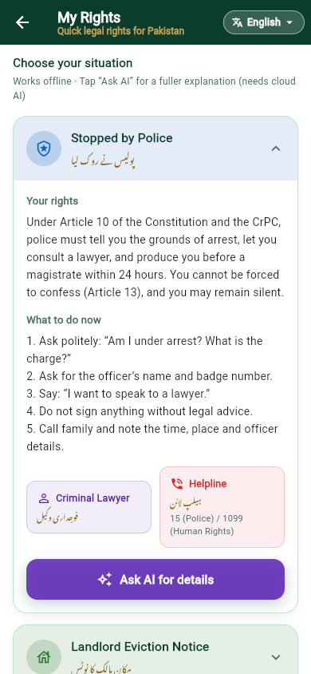
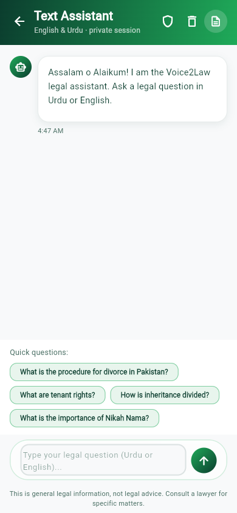
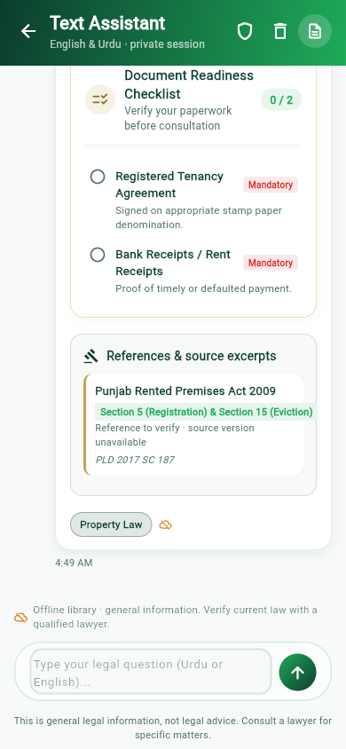

# Voice2Law

**Legal help that speaks Pakistan.** Voice-first legal guidance in Urdu and English, fully usable offline. Punjabi (Shahmukhi), Sindhi and Pashto answers are requested when cloud AI is enabled and fall back to English when a translation is unavailable.

> **NYLP AI Hackathon 2026 submission** · Flutter mobile + web · Working demo, source and AI methodology documented below.

| | |
|---|---|
| **Live demo** | `TODO: add deployed web link before submitting` |
| **Demo video** | `TODO: add 2–3 minute video link before submitting` |
| **Submission form** | https://tally.so/r/D4rpdZ |
| **Platforms** | Android, iOS, Flutter Web |
| **Package** | `pk.voice2law.voice2law_app` · v1.2.0+3 |

---

## The problem

Pakistan has over 240 million people and a severe legal-aid gap. Most citizens cannot afford a lawyer for everyday problems — an arrest, an eviction notice, unpaid wages, online harassment, or a family dispute. Court documents and statutes are written in English and dense legal jargon. Legal aid desks are concentrated in cities, and the people who need help most often have low literacy or no reliable internet.

The result: people sign documents they do not understand, miss deadlines, pay touts, or give up on rights they actually have.

## The solution

Voice2Law turns a phone into a patient, multilingual legal explainer.

- **Ask naturally by voice or text.** Speak in Urdu or English; the app transcribes, understands, and answers in the language you choose.
- **Snap a legal document.** Photograph an FIR, notice, contract or court order and get a plain-language explanation of what it says, the dates that matter, and what to do next.
- **Know your rights before you act.** Offline "My Rights" cards cover the five situations people ask about most: police stops, eviction notices, cyber harassment, divorce/khula and workplace harassment.
- **15 practical AI tools.** Document drafting, deadline calculation, case intake, outcome estimation, precedent search, scam detection, mediation guidance, emergency SOS and more.
- **Find Lawyers — demo directory.** The lawyer directory now fetches sample profiles from the free, keyless [randomuser.me](https://randomuser.me) API and maps them to lawyer cards (city, court, expertise, rating and languages are derived deterministically from each record's UUID). Profiles are clearly labelled as demo data; photos, phone numbers, email and bar council numbers are deliberately left empty so no real person's photo or contact details are shown. The screen still falls back to an honest empty state with retry when the network is unavailable.
- **Privacy by design.** Conversations live in memory only. A quick-exit gesture replaces the screen with a calculator, stops the microphone and clears the session.

## What we built for the hackathon

### 1. Snap & Explain — vision-powered document understanding
`lib/screens/document_explainer_screen.dart` · `AiFeaturesService.explainDocumentImage`

Most legal-aid apps require users to type a document. That excludes exactly the users who need help. Snap & Explain sends the photo directly to Gemini's vision model, asks it to transcribe only what it can actually read, explains the document in plain language, extracts key dates and obligations, and flags unusual clauses. Blurry photos are acknowledged rather than guessed at, and the user can add typed context for a sharper answer.

- Camera or gallery input (`image_picker`)
- MIME type detected from the image bytes, so the provider always receives a valid format
- 8 MB guard and clear fallback to typed text
- Photo is sent only when the user taps **Explain**, with an on-screen privacy note
- Works with Gemini; other providers get an honest "paste the text instead" message

### 2. My Rights — offline-first rights cards
`lib/screens/rights_scenarios_screen.dart`

Five collapsible cards give an immediate answer without any AI call:

| Situation | What the card covers |
|---|---|
| Stopped by Police | Article 10 and Article 13 rights, 24-hour production, lawyer access |
| Landlord Eviction Notice | Rent Controller / Special Rent Tribunal, written notice, response steps |
| Cyber Harassment | PECA 2016, evidence preservation, FIA Cyber Crime Wing |
| Divorce / Khula | Union Council notice, Family Court khula, maintenance and mahr |
| Workplace Harassment | Protection Against Harassment Act 2010, inquiry committee, Ombudsperson |

Each card lists **your rights**, **what to do now**, the **type of lawyer** to consult and the relevant **helpline/tribunal**. English and Urdu are both shown when the app language is RTL. Tapping **Ask AI for details** optionally expands the card with a grounded cloud answer.

### 3. Multi-turn voice conversations
`lib/screens/voice_assistant_screen.dart`

Voice questions now carry the last six conversation turns into the AI request and record each exchange in the shared, memory-only conversation store. Follow-ups like *"what if I don't have a lawyer?"* resolve against what was already asked, instead of starting from zero. Quick exit still wipes the entire context.

## How the AI works

```
 User input
 ┌──────────────┬──────────────┬──────────────┐
 │ Voice (STT)  │ Text         │ Photo        │
 └──────┬───────┴──────┬───────┴──────┬───────┘
        │              │              │
        └──────────────┼──────────────┘
                       ▼
        ┌─────────────────────────────┐
        │ Retrieval / grounding       │
        │ • curated legal notes       │
        │ • bundled statute corpus    │
        │   (PPC, CrPC, PECA, MFLO,   │
        │    tenancy, limitation…)    │
        └──────────────┬──────────────┘
                       ▼
        ┌─────────────────────────────┐
        │ Provider abstraction        │
        │ Gemini · Groq · Seena       │
        │ Gemini vision for photos    │
        └──────────────┬──────────────┘
                       ▼
        ┌─────────────────────────────┐
        │ Structured answer           │
        │ category · urgency · answer │
        │ Urdu/Punjabi/Sindhi/Pashto  │
        │ roadmap · documents · law   │
        └──────────────┬──────────────┘
                       ▼
        Offline fallback: LocalLegalBrain + statute corpus
```

**1. Grounded retrieval, not free-form guessing.**
Every question is matched against a curated Pakistani-law knowledge base and a bundled statute corpus (`assets/data/legal_corpus.json`). Retrieved excerpts are inserted into the prompt with an explicit instruction to prefer them and to quote exact section numbers. Reference cards shown to the user are built from **actual retrieved excerpts**, never from model-generated citation strings.

**2. Provider abstraction with graceful degradation.**
`MultiProviderAiService` routes one request shape to Gemini, Groq or Seena. If the selected provider fails (quota, timeout, no internet), the app automatically tries the other configured cloud provider, then falls back to `LocalLegalBrain`, labels the answer as offline, and tells the user what happened. The app never silently pretends an offline answer is a cloud answer. Snap & Explain vision uses Gemini (the only provider with a vision model in the supported set).

**3. Prompt safety.**
User text and retrieved documents are treated as untrusted data, not instructions. The system prompt forbids inventing precedents, requires uncertainty to be stated, asks for missing facts (province, dates), and only includes an emergency number when it is present in verified reference material.

**4. Multilingual output by design.**
A single JSON schema carries English, Urdu, Punjabi (Shahmukhi), Sindhi and Pashto fields. The selected language is requested explicitly; regional fields may be empty rather than machine-transliterated. Urdu uses the bundled Noto Nastaliq font.

**5. Vision for documents.**
For photos, Gemini receives the image inline as base64 with the same document-explainer system prompt, plus an instruction to state which parts are unreadable. Voice is handled by on-device speech recognition and TTS; cloud AI is never required to hear or speak.

**6. Human-centred guardrails.**
The app never displays a fake confidence percentage. Every AI feature carries the disclaimer that output is **general legal information, not certified legal advice**, and users are encouraged to verify with a licensed lawyer.

## Tech stack

| Layer | Choice |
|---|---|
| App | Flutter 3.44 / Dart 3.12 (Android, iOS, Web) |
| AI providers | Google Gemini (text + vision), Groq, Seena; local fallback |
| Retrieval | Hybrid keyword/concept retrieval over curated notes + bundled statute JSON |
| Voice | `speech_to_text` (STT), `flutter_tts` (TTS, Urdu voice support) |
| Document input | `image_picker` (camera/gallery, web file picker) |
| State & config | `ChangeNotifier` + `InheritedWidget` (`AppScope`) |
| Storage | `shared_preferences` for preferences; `flutter_secure_storage` for keys (mobile) |
| UI | Material 3, custom green/gold brand, Noto Nastaliq Urdu, light/dark themes |
| Tests | `flutter_test`, 194 tests including every named route at 390×844 with 1× and 2× text scale |

No backend is required for the core demo: direct-provider mode runs entirely from the device/browser. An optional backend contract exists for the lawyer directory and admin tools, but the hackathon demo does not depend on it.

## Screenshots

| Home | AI tools |
|---|---|
|  |  |

| Snap & Explain | My Rights |
|---|---|
|  |  |

| Text assistant | Answer with roadmap |
|---|---|
|  |  |

## Run locally

```powershell
flutter pub get
flutter analyze
flutter test
flutter run                 # connected device or emulator
flutter run -d chrome       # web
flutter build web --release
flutter build apk --release
```

The source tree starts with **cloud AI off** and the bundled offline library available. No API key is required to explore the UI, read the rights cards or get offline answers. Release artifacts built with `tool/build_demo.ps1` also ship **without any AI key**; builds can be pointed at a backend via `API_BASE_URL`, and users can paste their own key in Settings.

### Enable live AI (recommended)

AI keys are never compiled into the app — anything passed with `--dart-define` can be extracted from an APK or web bundle. Pick one of:

1. **Backend mode** — build with `API_BASE_URL` pointing at a server that holds the provider keys, then turn off "Call providers directly" in Settings so prompts go through `/ai/text` and `/ai/voice`.
2. **Bring your own key** — open **More → Settings / Preferences** in the app, enable cloud answers, choose a provider and paste a key at runtime:

   - **Gemini** — text and photo explanation (vision)
   - **Groq** — fast text answers
   - **Seena** — OpenAI-compatible endpoint, with base URL

```powershell
$env:API_BASE_URL='https://api.example.org/api'
powershell -File tool/build_demo.ps1
```

Keys pasted in the app are stored with platform secure storage on mobile and only in memory in the browser. **No API key, `.env` file or secret is committed to this repository.** Legacy plaintext credentials are discarded on first load.

## Validation

```text
flutter analyze   → No issues found
flutter test      → all 194 tests passing (widget, service, security and layout suites)
flutter build web --release → succeeded (no AI keys embedded)
flutter build apk --release → succeeded; signed release APK at releases/Voice2Law-1.2.0-release.apk (gitignored)
```

Live verification (19 October 2026, demo keys):

- all 13 cloud-backed AI tool forms returned real answers (Gemini quota-exhausted → automatic Groq fallback)
- Ask by Text returned a full Urdu answer via the same fallback
- Snap & Explain vision blocked by the Gemini free-tier 429 quota at test time; the vision request path is covered by mocked HTTP tests

The test suite covers:

- offline behaviour when cloud AI is disabled
- provider routing and the vision request payload (mocked HTTP)
- multi-turn context bounds
- mobile layout at 390×844, text scale 1.0 and 2.0, including a sweep of every named route
- quick-exit conversation clearing and audio stop
- Urdu/regional language field preservation
- secure credential handling and admin authorization

Cloud calls in tests are deterministic mocks; no paid credentials are used.

## Impact

- **Access:** works on low-end Android phones and in a browser; core rights content is free and offline.
- **Language:** meets users in Urdu and English offline; Punjabi, Sindhi and Pashto answers are requested from cloud AI, with an English fallback when unavailable.
- **Speed:** a photo or spoken question produces an actionable checklist in seconds, not after a queue at a legal-aid desk.
- **Trust:** grounded citations, explicit uncertainty and a visible "not legal advice" boundary.
- **Safety:** quick exit and memory-only sessions matter for survivors of domestic abuse or harassment.

## Limitations and responsible AI

- Output is **general legal information**, not legal advice. Laws change and provincial rules differ.
- The bundled corpus is a demo dataset and must be independently reviewed for currentness before real-world reliance.
- Cloud AI in the source tree requires the user's own key. The attached hackathon release artifacts ship with shared, public demo keys compiled in (Gemini + Groq, with automatic cross-provider fallback); they are rate-limited and should be rotated — build your own artifacts with `tool/build_demo.ps1`. Offline answers cover English and Urdu only; Punjabi, Sindhi and Pashto answers are requested from cloud AI (or the optional local-language bridge) and fall back to English when unavailable.
- Photo explanation depends on image quality. The model is instructed to say what it cannot read.
- Voice recognition uses the phone's installed service. Punjabi, Sindhi and Pashto recognition and playback work only where the device has those locales; otherwise the app falls back to the device default or an installed Urdu/English voice.
- A physical-device microphone/TTS session was not part of automated tests; browser support varies by platform.
- The optional lawyer directory/admin backend is not deployed for this demo and contains no fabricated records.

## Development tools used

- **Flutter SDK 3.44.7** with Dart 3.12.2 for cross-platform development
- **Android Studio** for Android development and emulator testing
- **VS Code** with Flutter extension for web development
- **Chrome DevTools** for debugging and performance profiling
- **GitHub** for version control and repository hosting
- **PowerShell** for build scripts and automation
- **Netlify / Vercel** (optional) for web deployment

## Challenges faced and lessons learned

**Challenge 1: Vision model quota limits**
- Gemini free tier vision API hit 429 errors during testing
- **Solution:** Implemented automatic cross-provider fallback (Gemini → Groq) and honest error messaging
- **Lesson:** Always design for graceful degradation; users need to know when a feature is offline

**Challenge 2: Regional language support on devices**
- Punjabi, Sindhi, and Pashto TTS voices are not available on all devices
- **Solution:** Fallback to device default or installed Urdu/English voices; clear language availability messaging
- **Lesson:** Test on real devices, not just emulators; provide honest limitations

**Challenge 3: Privacy vs. AI capabilities**
- Cloud AI features require sending user data; users in unsafe situations need discretion
- **Solution:** Memory-only conversations, quick-exit calculator camouflage, explicit privacy notes before photo upload
- **Lesson:** Privacy is a feature, not an afterthought; design for the most vulnerable users

**Challenge 4: Legal information accuracy**
- AI models can hallucinate precedents or misstate laws
- **Solution:** Grounded retrieval from bundled statute corpus, explicit instruction to quote exact sections, uncertainty disclosure
- **Lesson:** In high-stakes domains (law, health), retrieval-augmented generation is essential

**Challenge 5: Offline vs. cloud experience**
- Offline answers are faster but less comprehensive; cloud answers are richer but require connectivity
- **Solution:** Offline-first design for core rights, optional cloud expansion, clear labeling of answer source
- **Lesson:** Hybrid architectures work best in connectivity-challenged markets

## Team contributions

> Solo project — all development, design, and AI integration by a single contributor.

| Member | Role | Contribution |
|---|---|---|
| Ahmed Ali Ghori | Full-stack Developer | App architecture, Flutter UI/UX, AI provider integration, grounded retrieval system, vision-powered document explanation, offline-first design, multilingual support, testing, and documentation |

## Repository map

```
lib/
  core/          app config, DI scope, routes, language helpers
  models/        AiAnswer, ChatMessage, statutes, roadmap
  services/      AI providers, retrieval, speech, API, AI feature prompts, demo lawyer directory
  screens/       home, voice, text, AI hub, Snap & Explain, My Rights, settings…
  widgets/       brand components, legal UX components, sections
  theme/         colors, typography, Material 3 themes
assets/
  data/legal_corpus.json   bundled statute excerpts used for retrieval
  fonts/                   Noto Nastaliq Urdu
test/            widget, service, layout and security tests
shots/           screenshots used in this README
tool/            corpus build/benchmark scripts
```

## Operations

### Administrator access
Configure a server URL and a current admin ID token, then select **Verify & sign in**. `/auth/me` must return an admin role. There are no local demo credentials. Sessions expire after 30 minutes; five failed checks trigger a persisted 15-minute lockout. Authorization must also be enforced server-side on every protected endpoint.

### Android packaging
- Release APK: `releases/Voice2Law-1.2.0-release.apk` (signed with the project keystore, built with demo keys compiled in via `--dart-define`)
- Debug APK: `flutter build apk --debug` for development
- Rebuild both with your own keys: `powershell -File tool/build_demo.ps1`

### Branding
`assets/images/voice2law_logo.png` is the speech-and-justice mark. Android, iOS and web icons are regenerated with `dart run flutter_launcher_icons`. See `docs/BRAND_ASSET.md` and `docs/IMPLEMENTATION_REPORT.md`.

---

**Built for the NYLP AI Hackathon 2026.** If this app helps one person understand a document before signing it, it has done its job.
